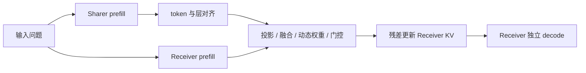

## 论文基本信息

- 作者：Tianyu Fu、Zihan Min、Hanling Zhang、Jichao Yan、Guohao Dai、Wanli Ouyang、Yu Wang。
- 原文：https://arxiv.org/abs/2510.03215
- 阅读版本：v2，2026-03-02；首次提交 2025-10-03。
- 代码：https://github.com/thu-nics/C2C
- 框架图：原文 Figure 5；下方为阅读者整理的流程。

## 一句话总结

冻结两个 LLM，训练 cache fuser，把 Sharer 对输入的内部表示融合进 Receiver 的 KV cache，省掉 Sharer 中间文本生成。

## 研究动机

文本既有顺序解码开销，也未必充分表达模型对同一问题的理解。作者的 enrichment oracle 在去掉示例 cache 后仍保留问题 cache 的收益，支持“问题表示本身可被上下文增强”的解释。

## 方法要点

两个模型各自 prefill；对齐 token 和层；用 fuser 合并相应 K/V；以残差方式更新 Receiver；后续只由 Receiver 解码，新生成 token 的 KV 仍来自 Receiver。

## 关键设计细节

- token：Receiver token 解码为字符串再用 Sharer tokenizer 编码，一对多选择覆盖最多的 token；属于近似对齐。
- 层：从末层向前对齐，层数不同时仅覆盖可对应部分。
- fuser：特征拼接、投影与融合、输入相关 head 权重、每层 gate；Gumbel-sigmoid 训练，推理门控趋向二值。
- 训练：标准 next-token loss，梯度穿过冻结 Receiver 到 fuser；主结果使用 OpenHermes2.5 的 50 万样本，其他实验另有 MMLU/LongBench 训练。
- 默认 fuser 478M 可训练参数，Receiver 为 596M；“冻结模型”不等于没有训练成本或额外容量。

## 实验设置与主要结果

主表 Receiver 固定 Qwen3-0.6B；使用四个选择题基准，greedy、最终输出上限 64 token，单 A100、batch=1 测延迟。

表 4 的 Sharer=Qwen2.5-0.5B 组合：

| 基准 | Receiver | 文本通信 | C2C |
|---|---:|---:|---:|
| MMLU-Redux | 35.53 | 41.03 | 42.92 |
| OpenBookQA | 39.20 | 44.00 | 52.60 |
| ARC-C | 41.04 | 49.48 | 54.52 |
| C-Eval | 32.04 | 35.88 | 41.77 |

单位为准确率百分比。表 3 的 MMLU 延迟分解：Receiver 单独 308ms、文本通信 1596ms、C2C 445ms，包含约 90ms 融合。省掉的是 Sharer 的中间 decode；不是普遍比单模型快。

## 优点

真正测试不同模型系列、规模和专长；保留 Receiver 的 cache 而非直接覆盖；对仅微调 Receiver、同模型 fuser 和异构 fuser 有控制实验。

## 局限与风险

- 需要为指定模型组合训练映射，尚未建立任意模型即插即用的通用接口。
- 主评测集中于小 Receiver 的选择题，长对话、工具使用和复杂生成结论不足；LongBench 使用任务内训练/测试切分，不能称为完全零样本长上下文迁移。
- Base Sharer 不遵循指令使文本通信极慢，14.41× 加速有特殊基线背景；摘要 2.5× 与主表分组合数字不能混作同一口径。
- 主结果只用固定训练 seed，未报告足以计算配对 p-value 的逐题预测和多 seed 方差，不能自行断言统计显著。
- token 近似映射、t-SNE 和有效秩均不是无损语义证明；Sharer 的错误也可能传递给 Receiver。
- 应同时计入两个模型、fuser、训练数据、显存与计算。控制实验支持异构信息有用，但不完全排除训练预算、容量和文本协议设计的影响。
- 表 6 中异构 fuser 相对同模型 fuser 的四任务均值增益约 1.55 个百分点；不能把相对未训练 Receiver 的全部增益都解释为跨模型互补。文本通信也应有相同数据训练的控制。

## 实践建议

这是阅读者建议，尚未运行复现：先明确是否确有两个互补模型；比较相同训练预算的 Receiver 微调、同模型 fuser、异构 fuser与短文本通信。上线评估须覆盖并发、长输入、模型升级后适配器重训及端到端成本。

## 贡献点

通过训练的 KV 融合，将跨模型通信放进 prefill，并将增强后的 cache 交给 Receiver 独立解码。

## 短评

比“模型共享内部表示”的抽象主张更具体，方法与消融有价值。但它更像一个有训练成本的双模型组合网络。与 [LatentMAS](LatentMAS.md) 的区别是：C2C 解决异构模型对齐，LatentMAS 解决同一基座多角色的潜在计算与 cache 复用。

## 参考资料

- [论文全文 v2](https://arxiv.org/html/2510.03215v2)：§3–4、表 3/4/6/8、附录 A.3。
- [官方实现](https://github.com/thu-nics/C2C)。
- [LatentMAS 笔记](LatentMAS.md)。
