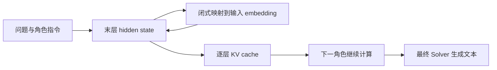

## 论文基本信息

- 作者：Jiaru Zou、Ruizhong Qiu 等。
- 原文：https://arxiv.org/abs/2511.20639
- 阅读版本：v4，2026-08-03；首次提交 2025-11-25。
- 代码：https://github.com/Gen-Verse/LatentMAS
- 框架图：原文 Figure 3；下方为阅读者整理的流程。

## 一句话总结

同一模型通过不同角色指令承担多个 Agent，在连续向量中进行中间计算，并直接复用 KV cache，只在最后生成文本。

## 研究动机

文本协作需要先逐 token 生成中间解释，再由后继 Agent 重新编码。作者尝试同时省掉中间文本解码和重复 prefill。

## 方法要点

1. 将末层 hidden state 作为下一步输入的来源，迭代产生 latent thoughts。
2. 用模型已有输入/输出矩阵计算对齐算子，缓解末层表示直接进入浅层的分布偏移。
3. 后继 Agent 接收逐层 KV cache，在前序上下文与 latent thoughts 上继续计算；最终 Agent 正常输出文本。

## 关键设计细节

按附录矩阵约定，对齐采用闭式 ridge 解：

\[
W_a=\beta^{-1}(W_{out}^{\top}W_{out}+\lambda I)^{-1}W_{out}^{\top}W_{in}.
\]

这里对齐的是同一模型的输出与输入空间，不是跨模型通信适配器。主实验采用 planner→critic→refiner→solver 或领域专家→summarizer。不同基座分别构建系统，不能理解为 Qwen 与 Llama 混合直接共享 cache。

## 实验设置与主要结果

评测覆盖九个数学、科学、常识和代码基准；Qwen3 4B/8B/14B，以及附录的 Llama 3B/8B。报告三次运行均值，latent steps 在 0/10/20/40/80 中调节。

表 1 的 Qwen3-8B 顺序系统：

| 任务 | Single | TextMAS | LatentMAS |
|---|---:|---:|---:|
| GSM8K | 81.1 | 92.3 | 93.8 |
| MedQA | 53.0 | 75.0 | 75.3 |
| MBPP+ | 64.8 | 69.5 | 74.6 |

单位为准确率百分比。相对 TextMAS 的均值加速报告为顺序 4×、层级 4.3×，输出 token 减少 70.8%/83.7%。这不等于相对单模型的同等加速，也不等于 FLOPs 同比例减少。不是每一格准确率都优于 TextMAS。

## 优点

免训练，容易验证；同时处理内部计算和通信；包含两种协作结构、多个模型和执行式代码评测。

## 局限与风险

- “无损”证明依赖同一模型、相同输入对应的 KV；证明 cache 复用与重算等价，不能推出真实知识完整性或异构模型无损传输。
- 表达能力证明采用线性语义基及三值系数假设，表示空间容量不等于解题能力。附录复杂度推导还把前述下界写成 O 关系，理论加速不宜当作实测结论。
- AIME 每年仅 30 题，3.3 个百分点约相当于一道题；三次均值不足以自行计算可靠配对 p-value。主表未提供足够逐题结果、方差及显著性检验。
- latent reasoning + text communication 消融只传最后 128 个解码 token，截断混入了通信方式比较。
- embedding 分散或 t-SNE 重叠不能单独证明更丰富的有效推理；debug 文本与正确率相关也不等于忠实解释潜在计算。

## 实践建议

这是阅读者建议，尚未运行复现：先用 HF 后端比较 Single、短文本 MAS、仅 cache 复用和完整 LatentMAS，固定最终生成预算并用验证集选 latent steps。统计准确率、配对置信区间、延迟、显存和实际计算步数。

官方代码说明 vLLM 使用 HF rollout + vLLM 最终生成的混合路径，并修改部分内部实现；官方结果建议使用 HF 复现，不能视作标准服务 API 的直接替换。

## 贡献点

将免训练的 latent rollout、输入输出对齐和多角色 cache 传递组合成完整协作流程。

## 短评

最有说服力的是减少中间文本后仍维持较好的任务表现；对“连续空间更强”“无损语义”的论证要保留。若目的是异构模型合作，应读 [C2C](Cache-to-Cache.md)；两者解决的问题不同。

## 参考资料

- [论文全文 v4](https://arxiv.org/html/2511.20639v4)：§3–5、附录 B/E/G。
- [官方代码与后端限制](https://github.com/Gen-Verse/LatentMAS)。
- [库内 CoD 笔记](../../CoT/CoD/CoD.md)：包含 Coconut 和减少思考文本的背景，不能将该笔记的历史判断当作本论文证据。
